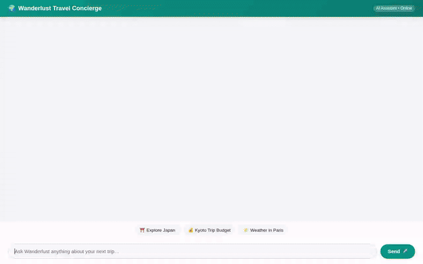

# 🌍 Wanderlust Travel Concierge

An intelligent, multi-modal travel concierge agent built with Google's **Agent Development Kit (ADK)** and powered by **Gemini 2.5 Flash**. Wanderlust helps travelers explore curated destinations, calculate itemized trip budgets, check real-time weather and currency exchange rates, remember preferences across sessions, and generate AI travel imagery and video previews.



---

## 🚀 Key Features & Capabilities

Wanderlust provides an end-to-end travel planning experience powered by the following integrated Google Cloud services and tools:

* **🧠 Long-Term Preference Memory (Vertex AI Memory Bank)**  
  Remembers user travel preferences, budget styles, dietary needs, and favorite destinations across sessions using Vertex AI Memory Bank (`PreloadMemoryTool` and custom memory callbacks).

* **🗄️ Curated Destination Database (Google Cloud Firestore)**  
  Queries a structured Firestore database of world destinations (e.g., Kyoto, Paris, Banff, Santorini, Rome) with filtered searches by tag, budget range, and country (`search_destinations`, `get_destination_details`, `save_destination`).

* **🎨 Scenic Photo Generation (Gemini 3.1 Flash Lite Image)**  
  Generates high-quality travel photography on demand using Imagen/Gemini image generation (`generate_destination_image`), automatically uploading images to Google Cloud Storage.

* **🎥 AI Video Previews (Google Gemini Omni Model)**  
  Creates short, cinematic 5-second video previews of travel spots using `gemini-omni-flash-preview` in the `global` Vertex AI region (`generate_destination_video`).

* **🪣 Media Storage & Public Hosting (Google Cloud Storage)**  
  Persists generated images and video clips to a public Cloud Storage bucket, returning permanent HTTPS URLs for embedded previewing.

* **📊 Itemized Trip Budget Calculator**  
  Computes detailed cost estimates (lodging, dining, activities, local transport) customized by duration, group size, and travel style (`calculate_trip_budget`).

* **🌤️ Live Global Weather**  
  Fetches real-time weather forecasts and current conditions worldwide via the Open-Meteo REST API (`get_live_weather`).

* **💱 Real-Time Currency Conversion**  
  Converts travel expenses between global currencies using live FX exchange rates (`convert_currency`).

* **🖼️ Rich A2UI 0.8 Card Interface**  
  Emits native A2UI JSON schema cards (`BasicCatalog` and row/column UI components) for visual rendering in the chat interface.

* **💬 FastAPI Chat Proxy & Web Interface**  
  A custom FastAPI backend proxy and lightweight web frontend (`frontend/`) supporting streaming agent responses and inline A2UI rendering.

---

## 🛠️ Architecture & Tech Stack

```
wanderlust-travel-concierge/
├── app/
│   ├── agent.py               # Root ADK agent, tools, system prompt & callbacks
│   ├── a2ui_utils.py          # A2UI card schemas & prompt formatting
│   └── fast_api_app.py        # ADK web proxy & FastAPI application
├── frontend/
│   ├── main.py                # FastAPI proxy server (A2A protocol)
│   ├── requirements.txt       # Frontend proxy dependencies
│   └── static/                # HTML/CSS/JS chat UI & A2UI card renderer
├── agents-cli-manifest.yaml   # Agent manifest configuration
└── pyproject.toml             # Python dependencies (adk, google-genai, google-cloud-*)
```

* **Framework**: Google Agent Development Kit (ADK) `0.1.0+`
* **Foundation Models**: `gemini-2.5-flash`, `gemini-3.1-flash-lite-image`, `gemini-omni-flash-preview`
* **Google Cloud Services**: Vertex AI Agent Engine, Vertex AI Memory Bank, Cloud Firestore, Cloud Storage, Cloud Run
* **Protocols**: Agent-to-Agent (A2A) Protocol, A2UI v0.8

---

## 💻 Local Setup & Development

### Prerequisites

Ensure you have the following tools installed:
* Python 3.10+
* `uv` package manager (`curl -LsSf https://astral.sh/uv/install.sh | sh`)
* Google Cloud SDK (`gcloud auth login` and `gcloud auth application-default login`)

### 1. Install Dependencies

```bash
agents-cli install
```

### 2. Set Up Environment Variables

Set your GCP project and regional configuration:

```bash
export GOOGLE_CLOUD_PROJECT="<your-gcp-project-id>"
export GOOGLE_CLOUD_LOCATION="us-east1"
```

### 3. Run Agent in Local Playground

To launch the interactive ADK development UI:

```bash
agents-cli playground
```

### 4. Run Custom Chat Frontend Locally

To run the custom FastAPI chat interface locally:

```bash
cd frontend
pip install -r requirements.txt
AGENT_ENGINE_RESOURCE_NAME="projects/<project-id>/locations/<region>/reasoningEngines/<engine-id>" \
AGENT_DIRECTORY="app" \
PORT=8080 \
python main.py
```

---

## 🚀 Deployment

### Deploy Agent to Vertex AI Agent Platform

```bash
agents-cli deploy --project <your-gcp-project-id> --no-confirm-project
```

### Deploy Frontend to Cloud Run

```bash
cd frontend
gcloud run deploy wanderlust-frontend \
  --source . \
  --region us-east1 \
  --allow-unauthenticated \
  --set-env-vars AGENT_ENGINE_RESOURCE_NAME="<your-reasoning-engine-resource-name>",AGENT_DIRECTORY="app"
```

---

## 📝 License

Apache License 2.0
